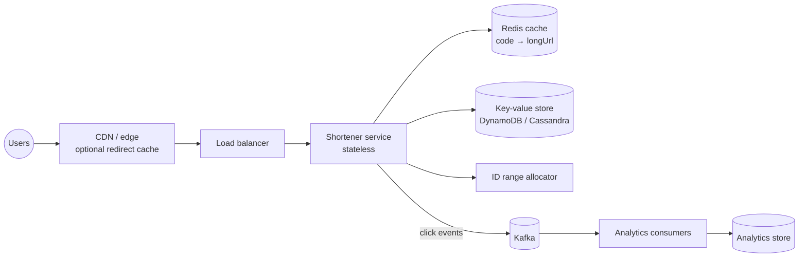

## Overview

A URL shortener turns `https://example.com/blog/2026/11/a-very-long-article-title?utm_source=newsletter` into `https://sho.rt/3Fq9Zk` and redirects visitors from the short URL to the original. It is a classic first system design question because it is small enough to finish, yet touches ID generation, encoding, caching, read-heavy scaling and analytics. It follows the [18-step framework](/system-design/introduction).

## Functional requirements

1. Given a long URL, return a short URL.
2. Visiting the short URL redirects to the long URL.
3. Optional custom alias (`sho.rt/summer-sale`) and optional expiry.
4. Basic analytics: click counts per link.

Out of scope: user accounts management UI, link editing, QR codes.

## Nonfunctional requirements

- **Highly available** redirects: a broken short link is a broken product. Target 99.99%.
- **Low latency** redirects: p99 < 50 ms at the edge.
- Short codes must be **unique** and **not guessable in sequence** (to avoid enumeration).
- Durable: a created link must never be lost.
- Analytics may be eventually consistent (minutes of delay is fine).

## Traffic and capacity estimates

Assumptions (labelled, to be confirmed with the interviewer):

| Assumption | Value |
|---|---|
| New URLs per day | 100 million |
| Read:write ratio | 10:1 |
| Retention | 10 years |
| Average stored record (long URL, code, metadata) | 500 bytes |

Calculations:

- **Write QPS:** 100 M / 86,400 s ≈ **1,160/s** (peak ×2 ≈ 2,300/s).
- **Read QPS:** 10 × 1,160 ≈ **11,600/s** (peak ≈ 23,000/s).
- **Records over 10 years:** 100 M × 365 × 10 = **365 billion**.
- **Storage:** 365 B × 500 bytes ≈ **182 TB**.
- **Code length:** with base62 (`[0-9a-zA-Z]`), 62⁶ ≈ 56.8 billion (too few), 62⁷ ≈ **3.5 trillion** (enough). Use **7 characters**.
- **Cache:** 20% of daily reads hit hot links; caching the top 20% of a day's links ≈ 0.2 × 100 M × 500 B = **10 GB** — fits easily in a Redis cluster.

## API design

```http
POST /api/v1/links
Content-Type: application/json
Idempotency-Key: 6f1c...

{ "longUrl": "https://example.com/blog/...", "customAlias": null, "expiresAt": null }

201 Created
{ "shortUrl": "https://sho.rt/3Fq9Zk", "code": "3Fq9Zk" }
```

```http
GET /3Fq9Zk
302 Found
Location: https://example.com/blog/...
```

```http
GET /api/v1/links/3Fq9Zk/stats   →   { "clicks": 1234, "byDay": [...] }
```

### 301 or 302?

| | 301 Moved Permanently | 302 Found (temporary) |
|---|---|---|
| Browser caches the redirect | Yes | No |
| Load on our servers | Lower (repeat visits skip us) | Every click reaches us |
| Analytics | Undercounts | Accurate |

Choose **302** when click analytics matter (the usual product requirement), 301 when minimising load is the priority.

## Data model

A single table, accessed only by code:

| Column | Type | Note |
|---|---|---|
| `code` | `varchar(7)` | Primary key |
| `long_url` | `text` | |
| `created_at`, `expires_at` | timestamp | |
| `owner_id` | bigint | Optional |

Plus a counters store for analytics. No joins, no transactions across rows — a key-value access pattern.

## Generating short codes

Two families of approach:

### A. Hash the long URL

`code = base62(first 43 bits of SHA-256(longUrl))`. The same URL always yields the same code (deduplication for free). But truncated hashes **collide**: on collision, append a salt and rehash, checking the database each time (a Bloom filter of existing codes makes the check cheap). Collisions grow with the dataset.

### B. Unique ID + base62 (chosen)

Generate a unique 64-bit ID (see [Unique ID Generation](/system-design/building-blocks/unique-id-generation)) and encode it in base62. No collisions by construction.

```java
private static final char[] ALPHABET =
        "0123456789abcdefghijklmnopqrstuvwxyzABCDEFGHIJKLMNOPQRSTUVWXYZ".toCharArray();

static String base62(long id) {
    var sb = new StringBuilder();
    do {
        sb.append(ALPHABET[(int) (id % 62)]);
        id /= 62;
    } while (id > 0);
    return sb.reverse().toString();
}
```

Sequential IDs give guessable codes (`3Fq9Zk`, `3Fq9Zl`...). To prevent enumeration, either **scramble** the ID with a reversible permutation (a small block cipher or multiplicative inverse modulo 62⁷) before encoding, or allocate IDs from random ranges. Each application server can take **ranges of IDs** (1,000 at a time) from a central counter, so code generation needs no network call per request.

**Custom aliases** are inserted with a uniqueness check (`INSERT ... ON CONFLICT DO NOTHING`); reserve words (`api`, `admin`) are blocked.

## High-level architecture



## Component responsibilities

- **Shortener service:** validates URLs, allocates codes, serves redirects. Stateless, horizontally scaled.
- **ID range allocator:** hands out ranges of IDs (backed by a strongly consistent counter, e.g. a database sequence or etcd).
- **Cache:** code → long URL for hot links; cache-aside with TTL.
- **Key-value store:** the system of record.
- **Kafka + analytics consumers:** record clicks asynchronously and aggregate them; redirects never wait for analytics.

## Data flow

**Create:** validate URL (scheme, length, blocklist) → take next ID from the local range → scramble and base62-encode → write `(code, long_url)` to the store → return the short URL.

**Redirect:** look up `code` in Redis → on miss, read from the store and populate the cache → publish a click event (fire-and-forget to a local buffer) → return 302. If the code is missing or expired, return 404 (and cache the miss briefly to resist [cache penetration](/system-design/building-blocks/caching-strategies#failure-modes-and-their-fixes)).

## Caching

Reads dominate (10:1) and popularity is highly skewed, so caching is the main lever. Cache-aside in Redis with an LRU policy and TTL; optionally cache redirects at the CDN edge for viral links (with 302 and a short `Cache-Control`, analytics come from CDN logs).

## Database selection

The access pattern is pure key lookup, 182 TB over 10 years, high availability — a **key-value / wide-column store** (DynamoDB, Cassandra) fits well, partitioned by `code`. A relational database with sharding also works; at smaller scale a single PostgreSQL with replicas is enough.

## Scaling

- Stateless services scale horizontally behind the load balancer.
- The store partitions by code hash; IDs are spread evenly after scrambling.
- Redis Cluster for the cache; CDN for global latency.
- The ID allocator is called once per 1,000 creations, so it is not a bottleneck.

## Failure handling

- **Cache down:** fall back to the store (capacity planned for it), with rate limiting to protect it.
- **Store region down:** multi-region replication; redirects served from the nearest healthy region.
- **Analytics pipeline down:** clicks buffer locally or in Kafka; redirects are unaffected.
- **Allocator down:** servers still have unused ranges; size ranges to survive minutes of outage.

## Security

- Validate and normalise URLs; reject `javascript:` and other dangerous schemes.
- Check long URLs against malware and phishing lists (Safe Browsing), and allow reporting.
- **Rate-limit** creation per API key and IP (see [Designing a Rate Limiter](/system-design/case-studies/rate-limiter)).
- Non-sequential codes prevent enumeration of private links.

## Observability

Redirect latency (p50/p99), cache hit ratio, 404 rate, creation rate per client, Kafka consumer lag for analytics.

## Bottlenecks

Hot links (a viral URL) concentrate on one cache shard: replicate hot keys or cache at the edge. Storage growth is linear and predictable.

## Design alternatives

- **Hash-based codes** with collision handling, giving natural deduplication.
- **Pre-generated key service:** generate random unused codes offline and hand them out from a pool.
- **Relational database** with read replicas at moderate scale.

## Trade-offs

- 302 costs more traffic than 301 but keeps analytics accurate.
- ID-based codes avoid collisions but need an allocator and scrambling.
- Asynchronous analytics are eventually consistent but keep redirects fast.

## Interview follow-up questions

**How would you support link expiry?** Store `expires_at`, check on redirect, set the cache TTL to the remaining lifetime, and delete expired rows with a TTL feature of the store or a background job.

**How do you avoid two users getting the same custom alias?** A conditional insert on the primary key; the second insert fails and the API returns 409.

**How would you count unique visitors?** HyperLogLog per link per day in the analytics pipeline.

## Summary

- Read-heavy: optimise redirects with caching and a key-value store.
- 7 base62 characters cover 3.5 trillion codes; generate them from unique IDs with scrambling.
- Choose 302 for analytics; process clicks asynchronously.
- Rate-limit creation and screen URLs for abuse.

## Related topics

- [Unique ID Generation](/system-design/building-blocks/unique-id-generation)
- [Caching Strategies](/system-design/building-blocks/caching-strategies)
- [Designing a Rate Limiter](/system-design/case-studies/rate-limiter)
- [Choosing a Database](/system-design/building-blocks/choosing-a-database)

## References

- Alex Xu. *System Design Interview – An Insider's Guide*. Chapter 8: Design a URL shortener.
- Alex Xu. *ByteByteGo System Design Handbook*: do you know how to generate globally unique IDs; cache miss attack.
