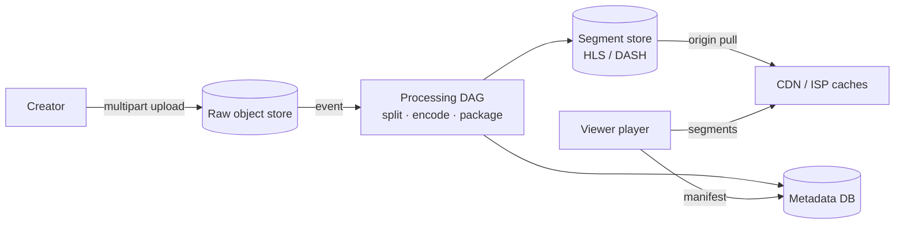

## Overview

A video platform has two very different halves: a **write path** where creators upload large files that are processed into many formats, and a **read path** where millions of viewers stream those formats with smooth playback on any network. Bandwidth, not compute, dominates cost, so most of the design is about **getting bytes close to viewers**. This case study follows the [18-step framework](/system-design/introduction).

## Functional requirements

1. Creators upload videos (up to several GB) and see processing status.
2. Viewers stream videos on phones, TVs and browsers with adaptive quality.
3. Video metadata, search, thumbnails, view counts.

## Nonfunctional requirements

- Playback starts within ~2 s; rebuffering is rare.
- Highly available read path; upload processing may take minutes.
- Cost-efficient storage and delivery; global audience.

## Capacity estimates

| Assumption | Value |
|---|---|
| Daily active viewers | 100 million, 5 videos/day each |
| Average watched bitrate | 3 Mbps, 5 minutes per video |
| Uploads | 500,000 videos/day, average 300 MB original |

- Egress: 500 M views × 5 min × 3 Mbps ≈ 500 M × 112 MB ≈ **56 PB/day** ≈ 5 Tbps average. This is why CDNs exist.
- Upload storage: 500 k × 300 MB = 150 TB/day originals; encoded renditions add 2–3×.

## API design

```http
POST /v1/uploads                       → { "uploadId", "partUrls": [...] }   (resumable, multipart)
POST /v1/uploads/{id}/complete         → { "videoId", "status": "PROCESSING" }
GET  /v1/videos/{id}                   → metadata + manifest URL
GET  https://cdn.example/v/{id}/master.m3u8   (HLS master playlist)
```

## High-level architecture





## Upload

Clients upload in parts (5–100 MB) directly to object storage using presigned URLs ([multipart upload](/system-design/building-blocks/choosing-a-database#block-file-and-object-storage)); a dropped connection only retries one part. On completion an event starts processing. The metadata service tracks status (`UPLOADED → PROCESSING → READY`).

## Transcoding as a DAG

Processing is a directed acyclic graph of tasks:

1. **Inspect and validate** (format, duration, malware/content checks).
2. **Split** into chunks aligned to keyframes (GOPs), so chunks encode independently and in parallel.
3. **Encode** each chunk into a **bitrate ladder**: for example 240p to 4K, several codecs (H.264 for compatibility, VP9/AV1/HEVC for efficiency). Netflix optimises encodes per title and per shot, using a perceptual quality metric (VMAF) to pick bitrates.
4. **Package** into short segments (2–6 s) with manifests: HLS (`.m3u8`) and/or MPEG-DASH (`.mpd`), plus DRM encryption.
5. **Thumbnails**, captions, and audio tracks in parallel.

A workflow engine schedules tasks on a worker pool (queues per task type, spot instances for cost), retries failed chunks, and marks the video ready when all required renditions exist. Popular formats can be encoded first and rarer ones later.

## Adaptive bitrate (ABR) playback

The player downloads the master manifest listing renditions, then fetches segments one at a time. After each segment it measures throughput and buffer level and picks the next segment's bitrate: low when the network is poor (avoid stalls), higher when the buffer is healthy. Because every rendition is cut at the same boundaries, switching mid-video is seamless. ABR logic runs **on the client**.

## Delivery: CDNs and ISP caches

Video popularity is extremely skewed: a small set of titles accounts for most views. Segments are cached at CDN edge locations. **Netflix Open Connect** goes further: Netflix places its own cache appliances inside ISP networks and at internet exchange points, and **pre-positions** content overnight based on predicted popularity, so most bytes never cross the wider internet. A steering service tells each client which nearby cache to use. Long-tail videos are served from regional caches or the origin.

## Metadata and views

- Video metadata (title, owner, status, renditions) in a sharded relational or document store, heavily cached.
- **View counts**: never update a row per view. Clients send playback events to a stream; aggregate in the stream processor and update counters in batches (approximate in real time, exact later). See [Stream Processing](/data-systems/stream-processing).
- Search uses a separate index fed by change events.

## Cost control

Encode only what will be watched (lazy encoding for rarely watched formats), use efficient codecs for high-volume titles, move cold originals to archival storage tiers, and push traffic to the cheapest healthy delivery path.

## Failure handling

- Transcoding task failures retry per chunk; poison inputs go to a dead-letter queue for review.
- CDN edge failure: clients fail over to another cache from the steering list.
- Player-level resilience: lower bitrate rather than stall.

## Security

Signed, expiring URLs for segments; DRM (Widevine, FairPlay, PlayReady) for premium content; content scanning on upload; rate limits on upload APIs.

## Trade-offs

- Storing many renditions costs storage but saves bandwidth and improves playback.
- Pre-positioning in ISPs is a huge investment that pays off only at very large scale.
- Short segments adapt faster but add request overhead; 2–6 s is the usual compromise.

## Interview follow-up questions

**How do you make uploads resumable?** Multipart upload with per-part retries and an upload ID that survives app restarts.

**How do you speed up transcoding of a 2-hour video?** Split into keyframe-aligned chunks and encode them in parallel, then stitch manifests.

**How does live streaming differ?** Ingest via RTMP/SRT, transcode in real time, publish segments continuously with short (low-latency) segments; no pre-positioning.

## Summary

- Upload in resumable parts to object storage; process with a parallel DAG.
- Produce a bitrate ladder of segmented renditions with HLS/DASH manifests.
- Clients adapt bitrate per segment; CDNs and ISP caches carry the bandwidth.
- Count views with streams, not row updates.

## Related topics

- [Caching Strategies: CDNs](/system-design/building-blocks/caching-strategies)
- [Batch Processing](/data-systems/batch-processing)
- [Designing File Storage and Sync](/system-design/case-studies/file-storage-sync)

## References

- Netflix. [Open Connect overview](https://openconnect.netflix.com/) and the Netflix TechBlog on per-title and shot-based encoding and VMAF.
- Alex Xu. *System Design Interview – An Insider's Guide*. Chapter 14: Design YouTube.
- Alex Xu. *ByteByteGo System Design Handbook*: upload large files; block, file and object storage.
