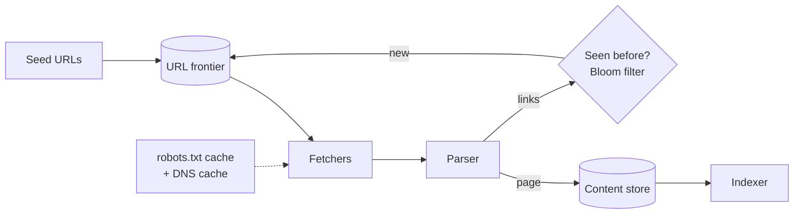

## Overview

A **web crawler** downloads web pages, extracts their links and downloads those in turn. Search engines, archives, price monitors and AI training pipelines all rely on crawlers. The algorithm is a breadth-first traversal; the engineering problems are **scale**, **politeness** (not overloading websites), **duplicate avoidance** and **robustness** against a hostile, messy web. ByteByteGo's "how to avoid crawling duplicate URLs at Google scale" focuses on exactly the dedup part.

## Functional requirements

1. Start from seed URLs; discover and fetch pages; extract links.
2. Store page content for indexing.
3. Respect `robots.txt` and crawl delays.
4. Revisit pages according to how often they change.

## Nonfunctional requirements

- Throughput: 1 billion pages per month.
- Politeness: never send more than a few requests per second to one host.
- Robustness: malformed HTML, slow servers, crawler traps, huge pages.
- Extensibility: new content types and processing steps.

## Capacity estimates

- 1 B pages / 30 days ≈ **400 pages/s** (peak ~800).
- Average page 500 KB → **200 MB/s** download, ~500 TB/month raw; store compressed (~5×).
- URL seen-set: 10 B URLs. A Bloom filter at 1% false positives needs ~9.6 bits per URL ≈ **12 GB**; an exact set of hashes would need ~80 GB.

## High-level architecture





## The URL frontier

The frontier is not a simple FIFO queue, because consecutive URLs often belong to the same host and would hammer it. The classic design (Mercator) has two layers:

```mermaid {title="Frontier: priority front queues, politeness back queues"}
flowchart LR
    IN[New URLs] --> PR[Prioritiser]
    PR --> F1[Front queue: high]
    PR --> F2[Front queue: medium]
    PR --> F3[Front queue: low]
    F1 & F2 & F3 --> SEL[Biased selector]
    SEL --> RT[Router: host → back queue]
    RT --> B1[Back queue host A]
    RT --> B2[Back queue host B]
    RT --> B3[Back queue host C]
    B1 & B2 & B3 --> H[Heap of next-allowed times]
    H --> W[Fetch workers]
```

- **Front queues** implement **priority** (PageRank, change frequency, freshness).
- **Back queues** implement **politeness**: each back queue holds URLs of one host; a heap records the earliest time each host may be contacted again (respecting `Crawl-delay` and adaptive delays based on response time).
- Distribute the frontier by **hash of the host** ([consistent hashing](/system-design/building-blocks/consistent-hashing)), so one host is always handled by one crawler node and politeness is local.
- Keep most of the frontier on disk with in-memory buffers at both ends.

## Fetching

- **robots.txt** fetched per host, cached (e.g. 24 h), and checked before each URL.
- **DNS resolution** is a hidden bottleneck (synchronous, 10–200 ms); run a local caching resolver and resolve asynchronously.
- Timeouts, maximum page size, redirect limits, and content-type filters.
- Fetchers are I/O bound: use asynchronous HTTP or [virtual threads](/java/advanced/virtual-threads-and-structured-concurrency), thousands of concurrent fetches per node.

## Deduplication in layers

| Layer | Catches | Technique |
|---|---|---|
| URL normalisation | `HTTP://Example.com:80/a/../b?utm_source=x` vs `http://example.com/b` | Lowercase host, remove default ports, resolve paths, drop tracking parameters, sort query |
| URL seen-set | URLs already crawled or queued | **Bloom filter** (fast "definitely new"), confirmed against a key-value store on "maybe seen" |
| Exact content | Identical pages under different URLs | Hash of the body (SHA-256) |
| Near-duplicate content | Pages differing only in ads, dates, session IDs | **SimHash** fingerprints; pages within a small Hamming distance (≈3 bits of 64) are duplicates |

See [Probabilistic Data Structures](/system-design/building-blocks/probabilistic-data-structures) for Bloom filters, and their inability to delete (rotate filters, or use counting/cuckoo filters).

## Crawler traps

Infinite URL spaces — calendars with "next month" links forever, session IDs in URLs, generated directories — can absorb a crawler. Defences: maximum URL length and depth, per-host page budgets, detection of repeating path patterns, and ignoring known session parameters.

## Storage

- Page content: compressed in object storage or WARC files, keyed by URL hash.
- Metadata (URL, last crawl time, status, content hash, change rate) in a wide-column store.
- Output feeds [batch processing](/data-systems/batch-processing) for indexing, link analysis (PageRank) and analytics.

## Recrawling and freshness

Pages change at different rates. Track each URL's observed change frequency and schedule recrawls accordingly; use conditional requests (`If-Modified-Since`, `ETag`) and sitemaps' `lastmod` to avoid downloading unchanged pages.

## Failure handling and scaling

Crawl nodes checkpoint frontier state; a node failure reassigns its hosts. Scale by adding nodes and rebalancing host partitions. Monitor per-host error rates and back off from failing hosts.

## Trade-offs

- Bloom filters trade a small chance of skipping a never-seen URL for a ~7× memory saving.
- Politeness caps throughput per host; parallelism must come from crawling many hosts at once.
- Freshness versus coverage: crawl budget is finite.

## Interview follow-up questions

**How do you avoid overloading a site?** One back queue per host, a minimum delay between requests per host, adaptive slowing on errors, and robots.txt.

**What happens on a Bloom filter false positive?** A genuinely new URL is skipped. At 1% this is usually acceptable, or the "maybe seen" case is verified against an exact store.

**How do you crawl JavaScript-heavy sites?** A headless-browser rendering tier for selected pages, which is far more expensive, so it is prioritised.

## Summary

- The frontier balances priority (front queues) and politeness (per-host back queues).
- Partition by host; cache DNS and robots.txt.
- Deduplicate in layers: normalisation, Bloom filter, content hash, SimHash.
- Defend against traps and schedule recrawls by change rate.

## Related topics

- [Probabilistic Data Structures](/system-design/building-blocks/probabilistic-data-structures)
- [Consistent Hashing](/system-design/building-blocks/consistent-hashing)
- [Batch Processing](/data-systems/batch-processing)

## References

- Allan Heydon, Marc Najork. "Mercator: A Scalable, Extensible Web Crawler." *World Wide Web* 2(4), 1999.
- Gurmeet Singh Manku et al. "Detecting Near-Duplicates for Web Crawling." WWW 2007 (SimHash at Google).
- Alex Xu. *ByteByteGo System Design Handbook*: how to avoid crawling duplicate URLs at Google scale.
- [RFC 9309: Robots Exclusion Protocol](https://www.rfc-editor.org/rfc/rfc9309).
