## How to use this page

Each building block below has:

- a **Mermaid snippet** you can copy into an article (view the page source in the repository for the exact text);
- the component's **responsibility**;
- its typical **failure modes**;
- the main **trade-off** to mention.

The notation is consistent across this handbook:

| Shape | Meaning |
|---|---|
| Rectangle `["…"]` | Stateless service or component |
| Cylinder `[("…")]` | Stateful data store |
| Hexagon `{{"…"}}` | Message broker or queue |
| Rounded `("…")` | External system outside our control |
| Solid arrow `-->` | Synchronous request |
| Dotted arrow `-.->` | Asynchronous message, replication or background flow |

> [!TIP] Keep diagrams honest
> A diagram should show what the text explains, and the text should explain every box in the diagram. Label arrows with *what* flows (a request, an event, replication) when it is not obvious.

## Load balancer

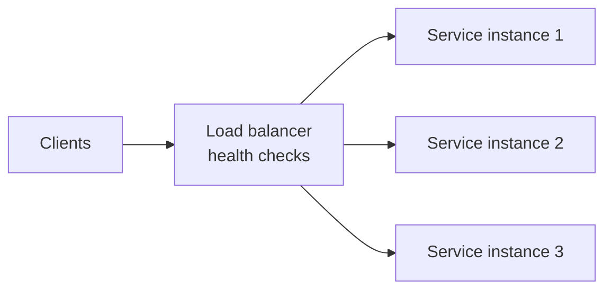

- **Responsibility:** distribute requests across healthy instances; terminate TLS (often); remove failing instances using health checks.
- **Failure modes:** the load balancer itself (deploy it redundantly or use a managed one); health checks that are too shallow (pass while the instance cannot serve) or too deep (fail when a shared dependency is down, removing every instance at once).
- **Trade-off:** Layer 4 (TCP) balancing is fast and simple; Layer 7 (HTTP) balancing enables routing by path or header, at higher cost.

## API gateway

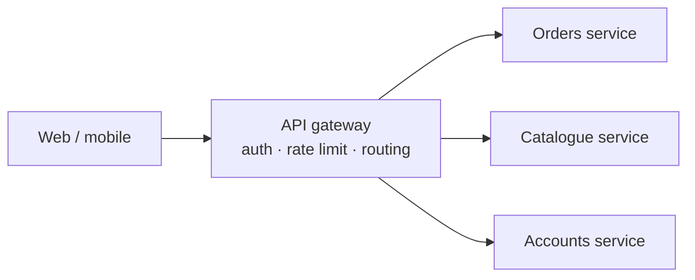

- **Responsibility:** one public entry point — authentication, rate limiting, request routing, sometimes response aggregation.
- **Failure modes:** a single point of failure and a bottleneck if under-provisioned; business logic creeping into the gateway.
- **Trade-off:** centralised cross-cutting concerns versus an extra network hop and a shared component that every team depends on.

## Application service

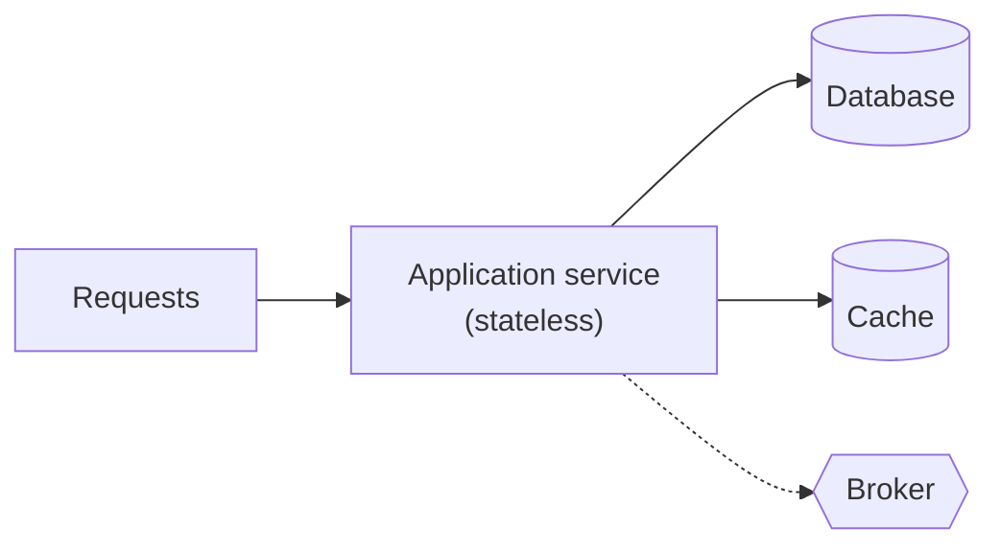

- **Responsibility:** business logic for one bounded context.
- **Failure modes:** thread or connection-pool exhaustion when a dependency is slow — use timeouts, circuit breakers and bulkheads.
- **Trade-off:** keeping services stateless makes horizontal scaling trivial but moves state into data stores.

## Database

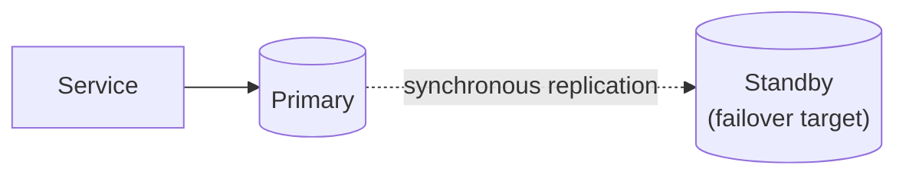

- **Responsibility:** durable system of record.
- **Failure modes:** primary failure (failover to standby; a few seconds to minutes of write unavailability), disk exhaustion, long-running queries holding locks.
- **Trade-off:** synchronous replication protects against data loss but adds write latency; asynchronous replication is faster but can lose the last few transactions on failover.

## Cache (cache-aside)

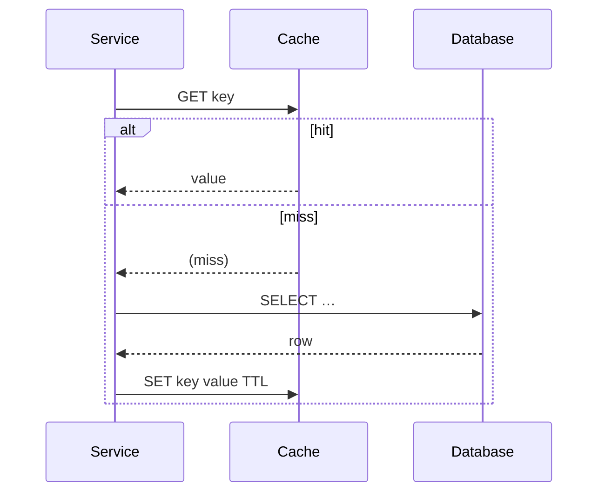

- **Responsibility:** serve hot reads with low latency and offload the database.
- **Failure modes:** stale data; a **cache stampede** when a hot key expires and many requests hit the database together (mitigate with request coalescing or early refresh); a cold cache after restart.
- **Trade-off:** latency and load reduction versus staleness and invalidation complexity.

## Message broker

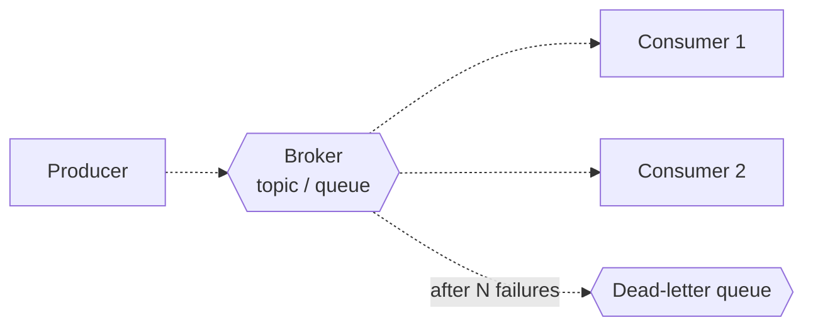

- **Responsibility:** decouple producers from consumers in time; buffer load spikes; fan out events.
- **Failure modes:** consumer lag growing without bound; poison messages blocking a partition (route them to a dead-letter queue); duplicate delivery (consumers must be idempotent).
- **Trade-off:** resilience and decoupling versus eventual consistency and harder debugging.

## Object storage

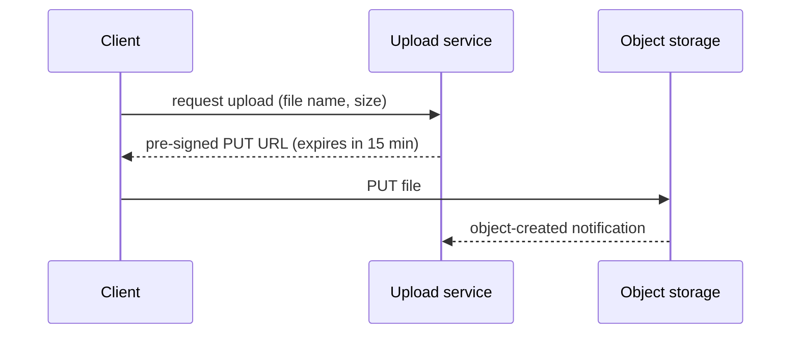

- **Responsibility:** cheap, durable storage for files and large blobs; often served through a CDN.
- **Failure modes:** orphaned objects when uploads are abandoned (use lifecycle rules); public buckets exposing private data.
- **Trade-off:** very high durability and low cost per gigabyte versus higher latency than block storage and no in-place updates.

## Search index

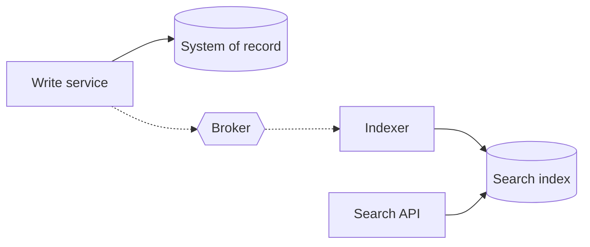

- **Responsibility:** full-text search, faceting and relevance ranking.
- **Failure modes:** index lagging behind the system of record; mapping changes requiring a full reindex.
- **Trade-off:** rich queries versus a second copy of data that is eventually consistent. The database remains the source of truth.

## External service

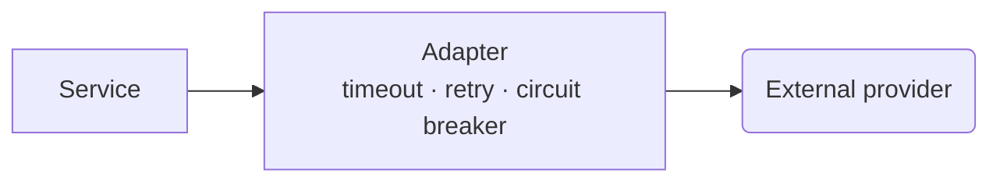

- **Responsibility:** integrate a capability you do not own (payments, e-mail, maps).
- **Failure modes:** slowness, outages, rate limits, changing APIs, ambiguous results on timeout.
- **Trade-off:** buying a capability versus depending on another organisation's availability. Isolate it behind a port and an adapter (see the [Adapter pattern](/design-patterns/structural/adapter)).

## Replication

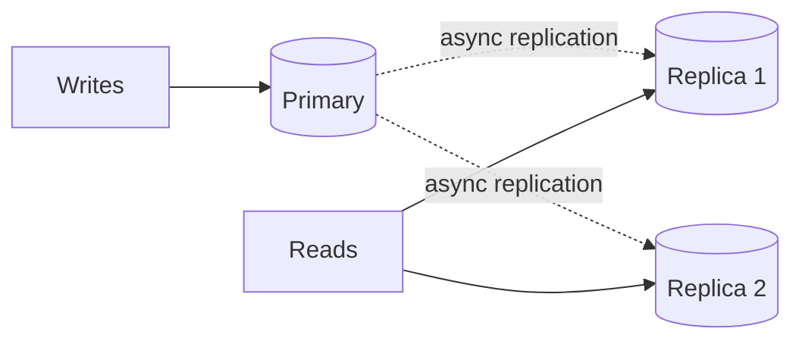

- **Responsibility:** scale reads and provide redundancy.
- **Failure modes:** replication lag — a user writes and then reads stale data from a replica. Mitigate by reading your own writes from the primary for a short period after writing.
- **Trade-off:** more read capacity versus consistency anomalies.

## Sharding

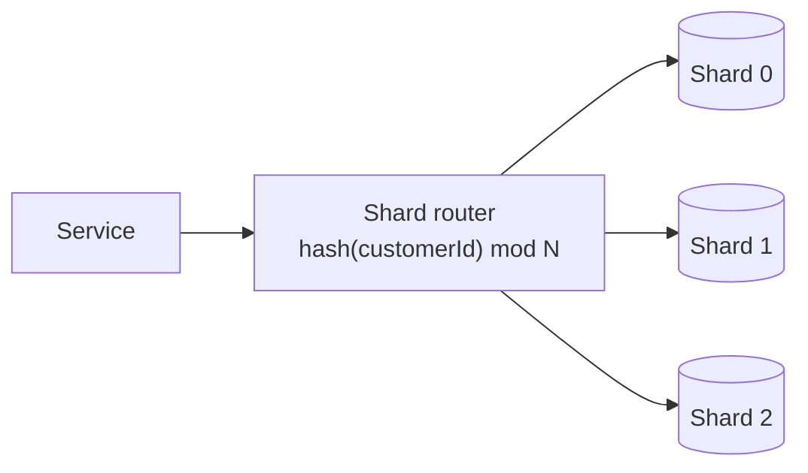

- **Responsibility:** spread data and write load across several databases when one node is not enough.
- **Failure modes:** hot shards (a celebrity key); expensive cross-shard queries; painful resharding. Consistent hashing or directory-based routing reduces data movement when shards are added.
- **Trade-off:** near-linear write scaling versus loss of cross-shard transactions and joins, plus significant operational complexity. Shard only when estimates require it.

## Event flow

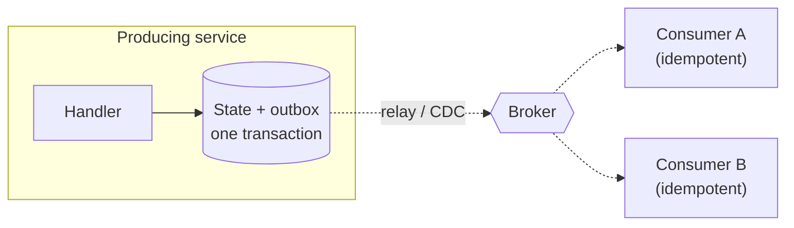

- **Responsibility:** propagate facts between services reliably.
- **Failure modes:** lost events (prevented by the outbox), duplicate events (handled by idempotent consumers), out-of-order events (partition by aggregate ID).
- **Trade-off:** loose coupling and resilience versus eventual consistency and harder end-to-end tracing. See the [order management case study](/system-design/case-studies/order-management-system#data-flow) for a complete example.

## Related topics

- [Introduction to System Design](/system-design/introduction)
- [Designing an Order Management System](/system-design/case-studies/order-management-system)

## References

- [Mermaid documentation](https://mermaid.js.org/intro/) — flowchart, sequence, class, state and ER diagram syntax.
- Martin Kleppmann. *Designing Data-Intensive Applications*. O'Reilly, 2017. Chapters 5 (replication) and 6 (partitioning).
