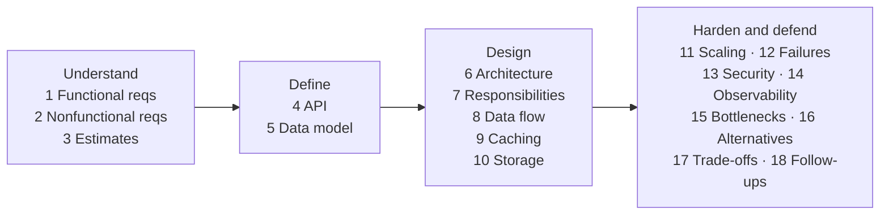
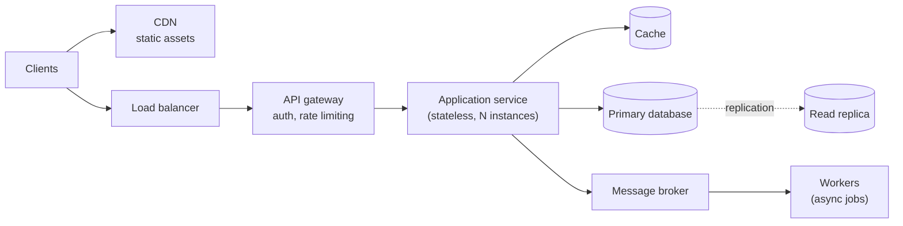

## Simple definition

**System design** is the process of turning a set of requirements into an architecture — components, data, interfaces and their interactions — that meets those requirements at the expected scale, and that you can explain and defend.

In interviews, it is a 45–60 minute conversation in which you design a system such as a URL shortener, a chat service or an order-processing platform. In real work it is the same thinking, with more time, real data and real constraints.

## The problem

System design questions are deliberately vague: "Design an order management system." Candidates and engineers alike fail in predictable ways:

- They jump to technologies ("Kafka, Cassandra, Kubernetes") before understanding the requirements.
- They design for imaginary scale, or ignore real scale.
- They draw boxes without explaining what each box does or why it exists.
- They present one design as obviously correct, without trade-offs.

A **repeatable framework** prevents all four. It also makes your reasoning visible, which is what interviewers actually assess.

## The 18-step framework

Every case study in this handbook follows these steps. In an interview, steps 1–6 take roughly the first third of the time; you will not reach every later step in depth, so prioritise the ones the interviewer cares about.

| # | Step | Key question |
|---|---|---|
| 1 | Functional requirements | What must the system do? |
| 2 | Nonfunctional requirements | How well: latency, availability, consistency, durability, security? |
| 3 | Traffic and capacity estimates | How much load and data, and therefore what scale? |
| 4 | API design | What does the system expose? |
| 5 | Data model | What entities exist and how are they accessed? |
| 6 | High-level architecture | What are the major components and how do they connect? |
| 7 | Component responsibilities | What does each box do — and not do? |
| 8 | Data flow | How does a request or event move through the system? |
| 9 | Caching | What can be cached, where, and how is it invalidated? |
| 10 | Database selection | Which storage fits the access patterns and consistency needs? |
| 11 | Scaling | How does each component grow with load? |
| 12 | Failure handling | What happens when each dependency is slow or down? |
| 13 | Security | Authentication, authorisation, data protection, abuse prevention |
| 14 | Observability | How do we know it works, and diagnose it when it does not? |
| 15 | Bottlenecks | Where will it break first as load grows? |
| 16 | Design alternatives | What other designs were possible? |
| 17 | Trade-offs | What did we give up, and why is that acceptable? |
| 18 | Interview follow-ups | What would we change if the requirements changed? |



## Steps 1–2: requirements

### Functional requirements

List the core use cases, then **explicitly scope out** the rest. For an order system: place an order, pay for it, view order status, cancel before shipment. Out of scope: product catalogue management, recommendations, returns.

### Nonfunctional requirements

Turn adjectives into numbers. Ask, or state assumptions clearly.

| Attribute | Vague | Specific |
|---|---|---|
| Latency | "Fast" | p99 of order placement < 500 ms, excluding the payment provider |
| Availability | "Always up" | 99.95% monthly for order placement (about 22 minutes of downtime per 30 days) |
| Consistency | "Correct" | An order is never charged twice; stock may be oversold by at most a small, reconciled amount |
| Durability | "Don't lose data" | A confirmed order is never lost (replicated before acknowledgement) |
| Scale | "Lots of users" | See the estimates below |

> [!KEY] Label every assumption
> If the interviewer has not given a number, do not invent one silently. Say: "**Assumption:** 10 million monthly active users — please correct me if that's off." Then reason from it. This handbook marks assumptions explicitly in every case study.

## Step 3: capacity estimation

Back-of-the-envelope estimates decide whether you need one database or fifty. Aim for the right **order of magnitude**, not precision.

### Useful constants

| Quantity | Approximate value |
|---|---|
| Seconds per day | 86,400 ≈ 10⁵ for mental arithmetic (this understates per-second rates by about 14%) |
| Seconds per month | ≈ 2.6 × 10⁶ |
| 1 million requests/day | ≈ 12 requests/second on average |
| Read from memory (1 MB, sequential) | Microseconds |
| Round trip within one data centre | ≈ 0.5 ms |
| Read 1 MB sequentially from SSD | ≈ 1 ms or less, depending on the device |
| Round trip between continents | ≈ 100–150 ms |

Latency figures vary with hardware; use them for ratios ("memory is about a thousand times faster than a cross-region call"), not exact budgets.

### A worked example

**Assumptions** (stated, not given):

- 10 million daily active users (DAU).
- Each user views 20 pages per day and places 0.05 orders per day on average (one order every 20 days).
- Peak traffic is 5× the daily average (promotions, evenings).
- An order record, including its lines, is about 2 KB.
- Orders are kept for 7 years.

**Read traffic:**

```text
page views/day     = 10,000,000 × 20             = 200,000,000
average reads/s    = 200,000,000 / 86,400        ≈ 2,300
peak reads/s       = 2,300 × 5                   ≈ 11,500
```

**Write traffic:**

```text
orders/day         = 10,000,000 × 0.05           = 500,000
average orders/s   = 500,000 / 86,400            ≈ 6
peak orders/s      = 6 × 5                       ≈ 30
```

**Storage:**

```text
per year           = 500,000 × 365 × 2 KB        ≈ 365 GB
7 years            = 365 GB × 7                  ≈ 2.6 TB  (before replication and indexes)
with 3 replicas    ≈ 7.7 TB; indexes and overhead could plausibly double that
```

**What the numbers tell us:**

- The system is **read-heavy** — about 400 reads per write. Caching and read replicas pay off.
- 30 orders per second at peak is modest. **A single well-tuned relational database primary can handle this write load**, so sharding is not needed for orders on day one.
- 2.6 TB over seven years fits in one database cluster, but **archiving** old orders to cheaper storage may be worth planning.

> [!MISTAKE] Precision theatre
> Calculating "2,314.8 requests per second" wastes interview time and implies false precision. Round aggressively and state the order of magnitude.

## Steps 4–5: API and data model

Define the API around the use cases, not the database:

```http
POST /orders                 Idempotency-Key: <uuid>
     → 201 Created, Location: /orders/{id}
GET  /orders/{id}            → 200 OK
POST /orders/{id}/cancel     → 200 OK | 409 Conflict (already shipped)
GET  /customers/{id}/orders?cursor=…&limit=20
```

Then the data model, driven by **access patterns**: "get order by ID", "list a customer's orders, newest first" and "find orders pending payment older than 15 minutes". Each access pattern suggests an index or a key design.

## Steps 6–8: architecture, responsibilities and data flow

Start with the simplest architecture that meets the requirements, then evolve it.



For each box, state one sentence of responsibility, and walk through the main request path step by step. The [Diagram Building Blocks](/system-design/diagram-patterns) page has reusable diagrams for each component.

## Steps 9–11: caching, storage and scaling

- **Caching**: cache what is read often and changes rarely. Decide on the invalidation strategy (TTL, write-through or event-driven) and accept the staleness explicitly.
- **Storage**: choose by access pattern and consistency need. Use a relational database for transactional data with relationships, a key-value store for simple lookups at very high scale, a search index for full-text search, and object storage for files.
- **Scaling**: keep services stateless and scale them horizontally behind a load balancer. Scale reads with replicas and caches. Scale writes with partitioning (sharding) only when one primary is no longer enough.

| Technique | Solves | Costs |
|---|---|---|
| Horizontal scaling of stateless services | CPU-bound request load | Needs externalised session state |
| Read replicas | Read-heavy database load | Replication lag, so reads may be stale |
| Caching | Hot reads, latency | Invalidation complexity, stale data |
| Sharding | Write throughput and data volume beyond one node | Cross-shard queries, rebalancing, operational complexity |
| Asynchronous processing | Spiky or slow work | Eventual consistency, more moving parts |

## Steps 12–15: failures, security, observability and bottlenecks

- **Failures**: for every dependency, ask what happens if it is slow, down or returns errors. Typical answers are timeouts, retries with backoff for idempotent operations, circuit breakers, fallbacks and queues.
- **Security**: authenticate at the edge, authorise every operation, encrypt in transit and at rest, validate all input, and rate-limit to prevent abuse.
- **Observability**: emit metrics for rate, errors and duration (RED), structured logs with correlation IDs, and distributed traces.
- **Bottlenecks**: walk the request path and ask which component saturates first as load grows ten-fold.

## Steps 16–18: alternatives, trade-offs and follow-ups

Finish by naming at least one serious alternative and why you did not choose it. "We could use event sourcing for orders; I chose a relational model with an outbox because we need simple queries and the team knows SQL." Then invite follow-ups, such as handling ten times the traffic or adding a second region.

## Common mistakes

> [!MISTAKE] Designing for Google scale by default
> Sharded NoSQL clusters, multi-region active-active deployments and dozens of microservices are rarely justified by the stated requirements. Over-design is as much a failure as under-design; let the estimates decide.

- Skipping requirements and estimates.
- Choosing technologies by name without stating what problem they solve.
- Ignoring failure paths: only drawing the happy path.
- Forgetting data growth and retention.
- Not leaving time for trade-offs and questions.

## Interview questions and answers

**How do you start a system design interview?**
By clarifying functional and nonfunctional requirements, agreeing on scope, and stating assumptions about scale. Then estimate capacity before drawing anything.

**Why do back-of-the-envelope estimates matter?**
They decide the architecture. They show whether one database suffices or sharding is needed, whether caching is critical, and how much storage to plan for.

**How do you scale a read-heavy system?**
Use caching at several levels (CDN, application cache), add read replicas, and denormalise or precompute read models. Accept bounded staleness where the requirements allow.

**How do you handle a slow downstream dependency?**
Set timeouts, use circuit breakers to fail fast, retry idempotent calls with exponential backoff and jitter, provide fallbacks or degraded responses, and move non-critical work to asynchronous queues.

> [!INTERVIEW] Narrate your reasoning
> Interviewers assess *how* you think. Say why you are making each choice and what it costs: "I'll add a cache here because reads outnumber writes 400 to 1; the cost is that order status can be stale for up to 5 seconds, which the requirements allow."

## Summary

- Use a repeatable framework: understand, define, design, then harden and defend.
- Turn vague requirements into numbers and label every assumption.
- Let capacity estimates drive architectural decisions.
- Start simple; add caching, replicas, queues and sharding only when the numbers justify them.
- Always discuss failures, alternatives and trade-offs.

## Related topics

- [Designing an Order Management System](/system-design/case-studies/order-management-system) — the framework applied end to end
- [Diagram Building Blocks](/system-design/diagram-patterns)
- [Microservices versus Modular Monolith](/microservices/fundamentals/microservices-vs-modular-monolith)
- [Introduction to Software Architecture](/software-architecture/introduction)

## References

- Martin Kleppmann. *Designing Data-Intensive Applications*. O'Reilly, 2017.
- Alex Xu. *System Design Interview – An Insider's Guide*, volumes 1 and 2. 2020, 2022.
- Jeff Dean. "Numbers Everyone Should Know", from talks on large-scale systems at Google.
- Betsy Beyer et al. *Site Reliability Engineering*. O'Reilly, 2016. Chapters on SLOs and handling overload.
